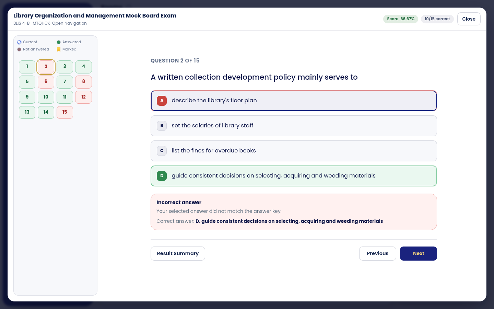
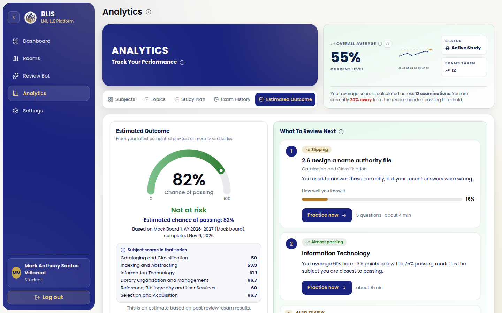
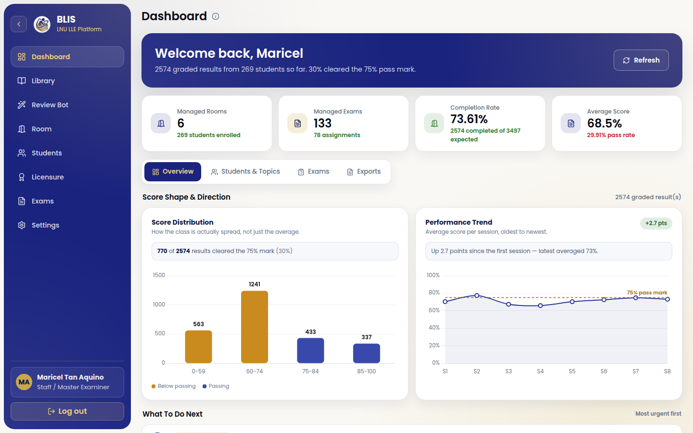
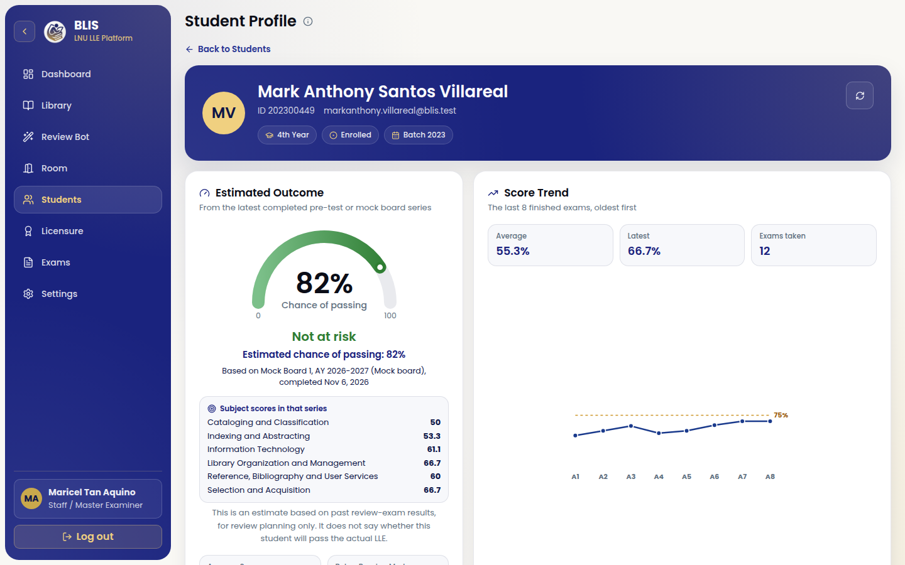
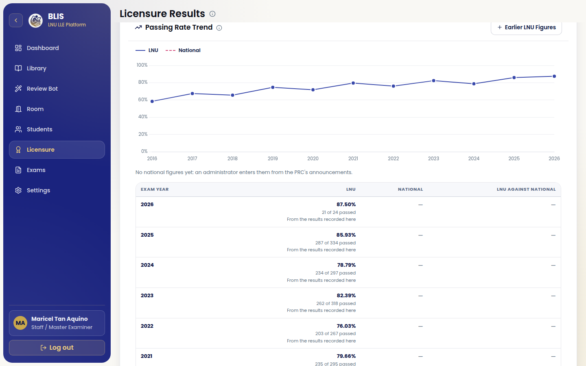
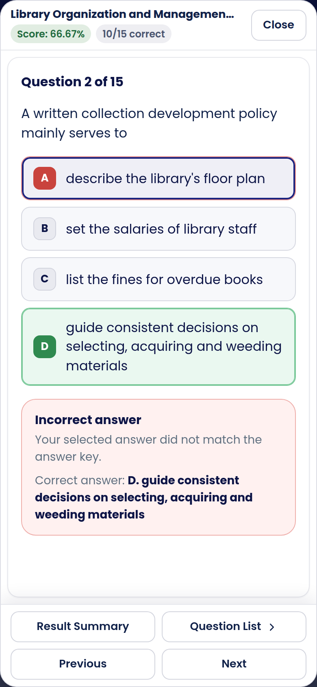

# BLIS: Mock Licensure Exam and Review Platform

**A web platform that helps Library Science students at Leyte Normal University prepare for the
Librarian Licensure Examination (LLE).** Students take timed mock board exams and practise their
weak topics; teachers build exams from their own Word question sets and follow every class; a
machine-learning model estimates each student's chance of passing from their mock board scores.

**[Live site: lnu-blis.live](https://lnu-blis.live)** · beta-tested at LNU since October 2026 ·
[Screenshots](#screenshots)


## Screenshots

All screenshots use the generated demo data: the names and scores are made up.

| | |
|---|---|
|  |  |
| **Exam review:** after submitting, a student goes through each question with the answer key | **Estimated Outcome:** the model's chance of passing, and the topics to review next |
|  |  |
| **Teacher dashboard:** how a class is doing, and what needs attention first | **Student profile:** one student's outlook and score trend, for their teacher |
|  |  |
| **Licensure results:** LNU's passing rate by exam year, beside the national rate | **On a phone:** every page is built for phones as well as desktops |

## What it does

| Role | Main features |
|---|---|
| **Student** | Joins a class room with a code; takes timed exams one question at a time, with a review screen before submitting; sees results and the answer key; practises weak topics with the Review Bot; follows their progress and Estimated Outcome on Analytics |
| **Teacher** | Uploads Word question sets (the answers, subject and topics are read from the file); creates and schedules exams; watches a class take an exam live and gives extra time; follows class results, question analysis and per-student profiles; exports reports as PDF, Excel and CSV |
| **Administrator** | Everything a teacher can do, across every teacher's work; plus user accounts, the end-of-school-year promotion, licensure results, retraining the prediction model, system settings, feedback and the audit log |

## Highlights

- **A prediction model that matches its reference.** The Estimated Outcome is a ridge-penalised
  logistic regression trained on past LNU examinees' mock board scores. The app retrains and
  cross-validates it in PHP, and its coefficients and evaluation figures match WEKA's to four
  decimal places. A retrained version goes live only if it meets its accuracy targets and does at
  least as well as the current one in cross-validation.
- **Topic mastery that follows each student.** Bayesian Knowledge Tracing over every exam a
  student has taken shows which of the 154 Table of Specifications topics they have mastered and
  which are slipping.
- **Reads question files however teachers wrote them.** A Word file's correct answers are found
  from however they were marked (highlight, shading, colour, bold or an answer key at the end),
  and each question is tagged with its subject and topic automatically. No outside AI service is
  used.
- **Built for a whole class sitting an exam at once.** Starting an exam can never create two
  attempts, answers save as the student goes, attempts past their time limit are submitted
  automatically, and pages update by themselves without a reload.
- **Deploys itself safely.** A merge to `main` goes live within minutes: the server backs up the
  database first, and waits until no student is in the middle of an exam.
- **Tested and checked.** 922 automated backend tests (98.9% statement coverage when last measured), sign-in
  tokens kept in HttpOnly cookies, rate limits sized for a campus behind one IP address, and an
  audit log of every change.

## Tech stack

| Area | Built with |
|---|---|
| Backend | Laravel 12 (PHP 8.2), Sanctum, MySQL 8.4, queued jobs and a scheduler |
| Frontend | Vue 3, Vite, Pinia, Vue Router, Chart.js; light and dark themes |
| Documents | PhpWord (question import), PhpSpreadsheet (Excel exports), DomPDF (PDF reports) |
| Machine learning | Logistic regression and Bayesian Knowledge Tracing in PHP, checked against WEKA 3.8.6 |
| Infrastructure | Docker (nginx, PHP-FPM, MySQL, queue worker, scheduler), AWS EC2, automatic deploys from `main` |

## Running it locally

Needs Docker and Node.js 22.

```bash
cp .env.example .env               # then fill in the database settings
cp .env.docker.example .env.docker
docker compose up -d
docker compose exec -T php composer install
docker compose exec -T php php artisan key:generate
docker compose exec -T php php artisan migrate --seed

cd frontend
npm install
npm run dev                        # http://localhost:5173
```

The seeded accounts and demo data are listed in `AGENTS.md` ("Seed Data").
phpMyAdmin is at http://localhost:8081 in development only.

## Tests

```bash
docker compose exec -T php php artisan test
```

About 920 backend tests. `AGENTS.md` ("Tests") describes running them in a throwaway container
so the development database is left alone, and measuring coverage.

## Where things are

```
app/            Laravel code: Models, Services (exam scoring, analytics, reports,
                Review Bot, Word import, machine learning), Support, Console commands
routes/api*.php the API, one file per area under routes/api/
database/       migrations, factories and seeders
frontend/src/   the Vue app: views/ (pages by role), components/, api/, stores/, utils/
ml/             the trained model, its training data and the Weka cross-checks
nginx/, docker/ server and container configuration
scripts/        auto-deploy and database backup scripts
docs/testing/   the test case document and how it is built
```

`AGENTS.md` is the detailed guide to the code's rules and behaviour; `DEPLOYMENT.md` covers
setting up the production server.

## License

All rights reserved. The code is public to read, but it may not be copied, reused or hosted
without written permission; see [LICENSE](LICENSE).
